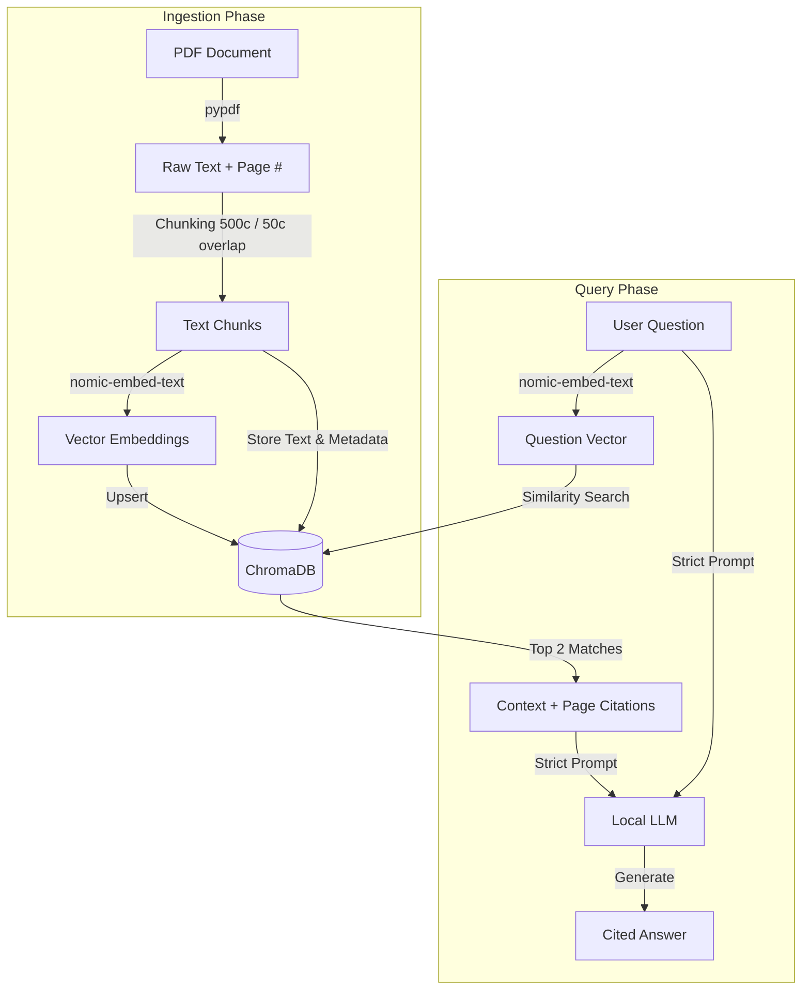

# 📄 ChatPDF: Local Document Q&A (Private RAG)

A pragmatic, 100% local Retrieval-Augmented Generation (RAG) pipeline. This tool allows you to ingest PDF documents, chunk their text, store them in a local vector database, and interactively ask questions about their contents—complete with page-number citations. 

Built as part of the **Local AI Engine & Private RAG** track.

## 🧠 System Architecture & Flow

The core philosophy of this project is separating the "Search" (Vector Math) from the "Read" (LLM Generation). The pipeline operates in two distinct phases:

### Phase 1: Ingestion (Write)
1. **Extract**: `pypdf` reads the PDF and extracts raw text page-by-page.
2. **Chunk**: The text is divided into ~500-character blocks with a 50-character overlap to prevent cutting sentences in half.
3. **Embed**: `nomic-embed-text` (via Ollama) translates each text chunk into a 768-dimensional mathematical vector.
4. **Store**: `ChromaDB` saves the vector (for math), the raw text (for the LLM), and the metadata (filename + page number).

### Phase 2: Query (Read)
1. **Embed Question**: The user's question is translated into a vector using the exact same model.
2. **Vector Search**: ChromaDB calculates the distance between the question vector and stored chunk vectors, returning the top 2 closest matches.
3. **Augment Prompt**: The retrieved text chunks are injected into a strict prompt template, complete with source citations.
4. **Generate**: The local LLM (`qwen2.5-coder:3b` or `llama3.2:3b`) answers the question using *only* the provided context.



## 🛠️ Tech Stack
* **Language**: Python 3.11+
* **Local AI Engine**: [Ollama](https://ollama.com/)
* **Embedding Model**: `nomic-embed-text` (~274 MB)
* **Generation Model**: `qwen2.5-coder:3b` (or `llama3.2:3b`)
* **Vector Database**: `chromadb`
* **PDF Parsing**: `pypdf`

## 🚀 Setup & Installation

**1. Clone the repository and navigate to the folder:**
```bash
git clone <your-repo-url>
cd pdf-document-rag
```

**2. Create and activate a virtual environment:**
```powershell
python -m venv .venv
.\.venv\Scripts\Activate.ps1  # Windows PowerShell
# source .venv/bin/activate   # Mac/Linux
```

**3. Install dependencies:**
```bash
pip install ollama pypdf chromadb
```

**4. Pull the required models via Ollama:**
```bash
ollama pull nomic-embed-text
ollama pull qwen2.5-coder:3b
```

## 💻 Usage

Place the PDF you want to query into the project folder.

**1. Ingest the PDF (Embed and Store):**
```bash
python chatpdf.py sample.pdf
```
*Output: `Ingesting 'sample.pdf'... Done! X chunks indexed.`*

**2. Start the interactive chat loop:**
```bash
python chatpdf.py
```
*Output:*
```text
--- Local ChatPDF Ready (Type 'exit' to quit) ---

Ask > What was the Phase 1 expenditure?
AI > Based on the context, the Phase 1 expenditure was $4.25M [sample.pdf Page 3].
```

## 🧠 Key Engineering Decisions
* **Idempotent Writes**: Uses `collection.upsert()` instead of `add()`. This prevents `DuplicateIDError` if you accidentally re-run the ingestion script on the same PDF.
* **Modern File Handling**: Replaced `os.path` with Python's `pathlib.Path` for robust, cross-platform file checking and metadata extraction.
* **Overlapping Chunks**: The chunking loop uses a step size of 450 with a chunk size of 500, creating a 50-character overlap. This ensures that facts spanning across chunk boundaries are not lost.
* **Stateless RAG**: The script uses `ollama.generate()` rather than `ollama.chat()`. Since the prompt contains the exact context needed, maintaining conversational history isn't required for single-shot Q&A, keeping the loop fast and memory-efficient.

## 🔒 Privacy
Everything runs locally. No data, PDFs, or queries are ever sent to the cloud. Your GPU (e.g., GTX 1660 Ti) handles both the embedding and generation entirely offline.
